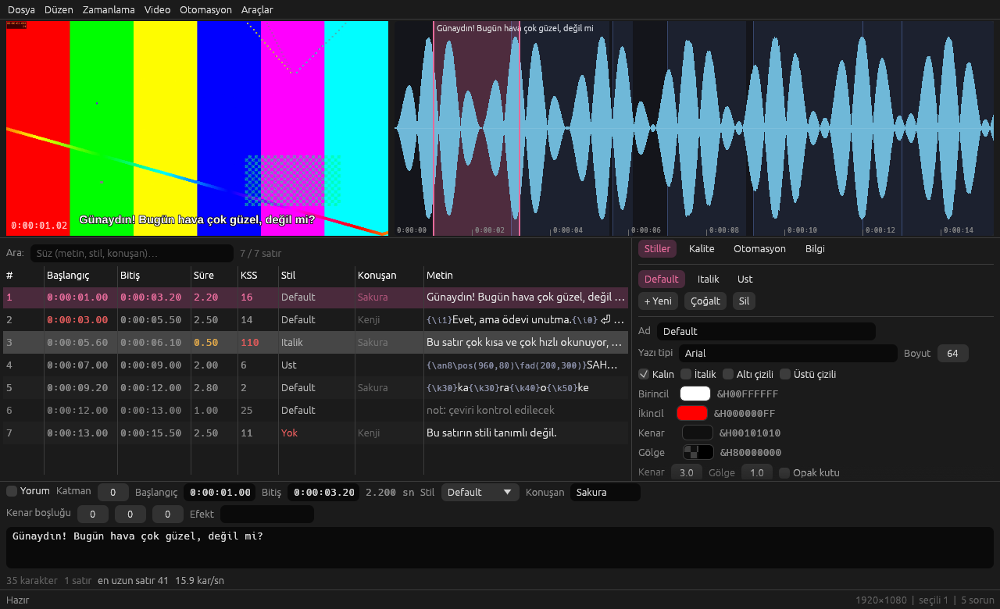

# osisub — anime altyazı stüdyosu

Hedef: Aegisub'ın işlevlerini, Subtitle Edit'in iyi özelliklerini ve anime altyazıcılığı için gereken her şeyi tek, hızlı ve kolay arayüzlü bir araçta toplamak; mevcut Aegisub Lua betiklerini (Automation 4) değişiklik olmadan çalıştırmak.

Not: Depo kökündeki `README.md` GitHub profil sayfasıdır; dokunulmaz. Proje belgeleri `docs/` altındadır.



## Mimari (Rust workspace)

| Crate | Görev |
|---|---|
| `osisub-core` | ASS/SSA/SRT/VTT/LRC/MicroDVD/SBV/TTML okuma-yazma (bayt-kararlı gidiş-dönüş), zaman/renk, etiket ayrıştırma ve temizleme, karaoke modeli, QC, "sık hataları düzelt", bul/değiştir, zamanlama son-işleyici, yeniden örnekleme, yazı tipi çıkarımı |
| `osisub-lua` | LuaJIT tabanlı Aegisub Automation 4 motoru: `aegisub.*`, `subs`, `register_macro/filter`, `dialog.display`, `progress`, `re`, `unicode`, `utf8`, `lfs`, `clipboard`, `karaskel.lua`, `utils.lua`, gerçek yazı tipi ölçüleriyle `text_extents` |
| `osisub-doc` | Arayüzden bağımsız belge modeli: seçim, geri al/yinele (yazma birleştirme), komutlar, pano, Lua arka plan çalışanı |
| `osisub-media` | ffmpeg/ffprobe: ortam bilgisi, ses dalga formu, libass'lı video kareleri/akışı, anahtar kareler, konuşma tespiti |
| `osisub-cli` | `osisub` komutu: convert, check, fix, fixes, shift, post, resample, find, fonts, batch, macros, run, info |
| `osisub-gui` | egui/eframe arayüzü |

## Arayüz özeti

- Izgara (100k satır akıcı), sağ tık menüsü, Ctrl+C/X/V (ASS satırları ya da düz metin), sürükle-bırak (altyazı/video/Lua)
- Düzenleme paneli: zaman, stil, konuşan, kenar boşlukları, efekt, metin; karakter/satır/KSS sayacı; referans altyazı
- Medya paneli: libass'lı video önizleme, dalga formu (kaydır/yakınlaştır, sürükleyerek zamanlama, kare + anahtar kareye yapışma), F5 ile video+ses oynatma, videoda `\pos` sürükleme
- Sekmeler: Stiller (görsel düzenleyici), Karaoke (hece çubuğu), Kalite (QC), Otomasyon (Lua), Bilgi
- Araçlar: Bul/Değiştir (regex, Türkçe i/İ), Sık hataları düzelt, Yazı tipi denetimi, Çözünürlüğü yeniden örnekle, Zamanlama son-işleyici, Sesten satır oluştur (VAD)

Kısayollar: `docs/HOTKEYS.md`.

## Lua uyumluluğu

- Satır tabloları Aegisub ile aynı alanları taşır (`class`, `section="[Events]"`, `start_time`, `margin_t/b/v`, `extra`, `raw` ...).
- `subs[i]`, `#subs`, `subs.n`, `subs.append/insert/delete/deleterange`, `subs[0]=line`, `ipairs(subs)` desteklenir.
- Makrodan dönen seçim/aktif satır, `aegisub.cancel()`, `aegisub.set_undo_point` işlenir; doğrulama (`validate`) ve filtreler desteklenir.
- `include("karaskel.lua" | "utils.lua" | "unicode.lua" | "utf8.lua" | "*-auto4.lua")`; `require "re" / "unicode" / "utf8" / "lfs" / "ffi" / "bit" / "aegisub.util" / "aegisub.clipboard"`.
- İletişim kutuları: CLI'de varsayılanlar + `--param ad=değer`; GUI'de gerçek diyalog.
- Videodan `aegisub.frame_from_ms`, `ms_from_frame`, `video_size`, `get_audio_selection`, `project_properties`.
- Betikler: komut satırında `--lua`, GUI'de Otomasyon menüsü ya da `~/.config/osisub/automation/autoload/*.lua`.

## Geliştirme

```
cargo test --workspace --exclude osisub-gui   # tüm testler
cargo build --release                         # target/release/osisub, osisub-gui
target/release/osisub --help
```

Başsız GUI doğrulaması (ekran görüntüsü): `apt-get install libxkbcommon-x11-0 xvfb ffmpeg`, sonra
`LIBGL_ALWAYS_SOFTWARE=1 xvfb-run -a target/debug/osisub-gui dosya.ass --media video.mkv --tab karaoke --line 5 --open timing --screenshot cikti.png`.

Bilinen eksikler ve sıradaki işler: `docs/ROADMAP.md`. Gece gece ilerleme: `docs/DEVLOG.md`.
